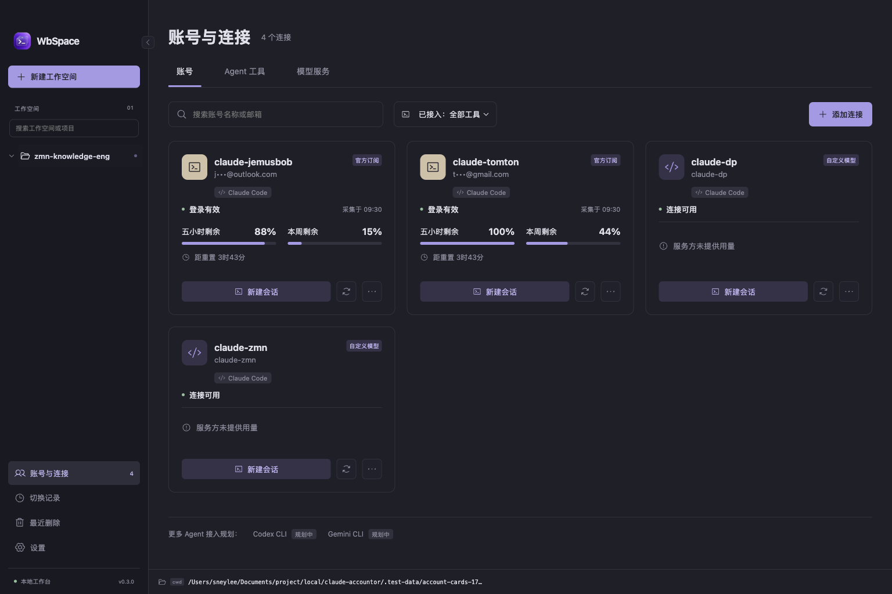

# WbSpace

以本地工作空间和内置终端为中心的 macOS 桌面应用，管理 Agent CLI 的账号、会话、用量与项目文件。

当前版本 **0.3.0（未公证内测）** 接入 Claude Code，支持自动隔离的官方订阅账号，以及自定义供应商、密钥和模型配置。Codex CLI、Gemini CLI 等仍在接入规划中，界面不会将它们标为已连接。



截图使用隔离演示数据，额度不是用户实时余额。

## 安装内测版

[下载 DMG（macOS Apple Silicon · 未公证内测）](https://github.com/SneyRio/Terminal-Workbench/releases/download/v0.3.0-beta.1/WbSpace-0.3.0-mac-arm64-unsigned-beta.dmg) · [Release、校验值及安装说明](https://github.com/SneyRio/Terminal-Workbench/releases/tag/v0.3.0-beta.1)

当前提供 WbSpace macOS Apple Silicon DMG/ZIP。DMG 拖入 Applications；首次打开若因未验证开发者而拦截，可在系统设置的隐私与安全性中对该应用确认“仍要打开”，受管电脑可能禁止放行。包仅有完整临时签名，没有 Developer ID 和 Apple 公证。

用户需自行安装 Claude CLI，首次启动指南可检测或选择可执行文件，再添加账号与工作空间。详见 [安装、升级及本机恢复说明](docs/install-beta.md)。项目源码推送不代表 GitHub Release 已发布。

## 主要功能

- **工作空间**：多个有序本地项目，第一个项目根目录是 CLI 工作目录。左右导航可折叠，工作空间固定按创建时间倒序排列。
- **内置终端**：真实 PTY、多标签和分屏、搜索、复制、滚动、字体与行高设置；左侧与中间标签以边框跑马灯提示实际工作状态，遵循减少动态效果设置。仅支持内置终端，已移除外部终端联动。
- **账号卡片**：搜索、工具筛选、身份与认证状态、五小时及周剩余额度、重置倒计时、连接详情和快捷新建会话。
- **连接管理**：引用本机已配置的启动入口、自动生成官方独立账号目录和启动命令，或添加自定义供应商与多个模型。自定义模型不套用订阅额度条，底部状态栏与内置 HUD 回退也不显示订阅额度占位。
- **会话连续性**：精确会话 ID 恢复、同工具账号切换、检查点和明确标识的上下文交接。目标就绪后移除旧入口，失败保留原记录。
- **自动标题**：从首条有效任务摘取短标题，不额外调用模型；手动命名优先，恢复及切换保留标题。
- **最近删除**：按工作空间分组保留手动删除的会话 7 天，支持恢复和永久删除。自动替换不进入回收清单。
- **文件与 Git**：多项目文件树着色、文本编辑、Markdown/JSON/CSV/图片预览、冲突保护、上下拖动和内容放大、图形化 Git 差异；文件与文件夹可确认后移入系统回收站，保护未保存内容与项目根目录。
- **外观**：浅灰、黑夜、跟随系统、本地背景图片及透明度，内置 JetBrains Mono 字体。

## 运行环境

macOS Apple Silicon，或 Windows x64；开发需要 Node.js 22.12+、对应平台的 C++ 编译工具和自行安装的 Claude Code。Windows 适配及打包流程已加入，原生验收和发布状态见 [Windows 内测说明](docs/windows-beta.md)。Linux 尚未适配。

```sh
npm ci
npm run dev
```

构建与运行：

```sh
npm run build
npm start
```

生成 macOS 应用包：

```sh
npm run package:mac
```

产物位于 `release/builds.noindex/WbSpace-darwin-arm64/WbSpace.app`。尚未提供 Apple Developer ID 签名和公证。

如果 Electron 尚未下载或原生终端模块需要重建：

```sh
node node_modules/electron/install.js
npm run rebuild:native
```

## 开始使用

1. 打开“账号与连接”，添加连接。可选本机入口、独立官方配置、自定义供应商。官方账号自动生成独立目录和可复制的启动命令；点击“创建并登录”进入官方 CLI 授权。
2. 创建工作空间并选择本地项目，第一个项目作为主目录；为该工作空间选择默认连接。
3. 从工作空间新建 CLI / Shell，或从账号卡片选择工作空间后启动指定账号的会话。卡片启动不会改写其他会话或工作空间默认身份。
4. 从卡片的更多菜单查看详情、重命名、检查状态、切换当前会话账号或移除引用。模型服务页可新增和编辑自建连接的供应商名称、Anthropic 兼容地址、认证方式、密钥、模型列表与默认模型；原有脚本引用继续由原配置管理。
5. 在右侧编辑和预览文件。`Cmd+S` 保存，`Cmd+Shift+S` 保存文件区全部修改；文件快速打开遵循系统按文件类型的默认关联。

网页登录始终交给系统默认浏览器；不会选择特定浏览器或使用内置网页登录。

自定义服务当前需兼容 Anthropic Messages 协议，不直接接入普通 OpenAI 接口。密钥经 Electron safeStorage 使用系统安全存储加密后保存为本机加密文件（macOS 权限 0600），不进入普通状态或项目配置。编辑时密钥留空表示保留，修改在新启动/恢复的会话生效；检查配置只确认本地可用性，不发送推理请求。不同自定义服务间切换默认使用可预览的上下文交接。官方独立启动命令位于应用数据目录的 `bin/`，可在详情中复制完整路径；不会覆盖 `~/.local/bin` 的已有入口。

## 数据与恢复边界

认证由原 CLI 配置管理。引用已有入口不复制凭证，不改写原包装脚本或用户级 HUD。用量来自实际可用来源；“检查连接状态”不代表闲置账号额度已刷新，也不会通过模型请求探测余额。

新安装的数据目录为 macOS `~/Library/Application Support/WbSpace`，Windows `%APPDATA%\WbSpace`。从旧版 Claude Accountor 升级时继续使用旧数据目录，保留工作空间、账号引用、草稿和恢复资料。更名安装不会强行结束旧版进程；请先退出旧应用，再打开 WbSpace。

永久删除清除本工具的恢复记录和未被其他记录引用的专用检查点，不能再从本工具恢复；项目文件与原始 CLI 历史不会删除。Shell 恢复会创建同目录的新进程，不会复活已结束的命令。

原生会话恢复与可预览的上下文交接是两种不同方式。工具运行状态、后台进程和不同 Agent 的内部状态不能承诺完整迁移。跨 Agent 交接尚未实现。

## 验证与文档

```sh
npm test
npm run test:e2e
```

纯单元测试使用临时目录。桌面集成测试需要可运行的 macOS GUI；真实 CLI 恢复、已有账号检查等专项依赖本机配置的专用测试入口和测试会话，不是通用 CI 的前置条件。终端选区在深色、浅色和失焦时保持高对比，括号与中文拖选后可精确复制。

集成脚本可通过 `ACCOUNTOR_EXECUTABLE` 指向打包后的可执行文件，测试数据使用隔离目录。

- [新版 PRD 与选定方案](docs/prd/terminal-workbench-prd-v1.md)
- [实现和测试记录](docs/implementation-report.md)
- [视觉验收](design-qa.md)

新版本启动前会生成本机配置与加密密钥快照，保留最近五份；设置中可备份、查看备份和手动检查 GitHub Release。重复启动激活已有实例。当前更新需手动替换，不后台安装。

项目不会提交本机账号状态、凭证、测试数据、`node_modules` 或安装包。字体原始文件和 SIL OFL 1.1 许可证随源码及应用分发，见 [字体来源与许可](public/licenses/jetbrains-mono/source.json)。
