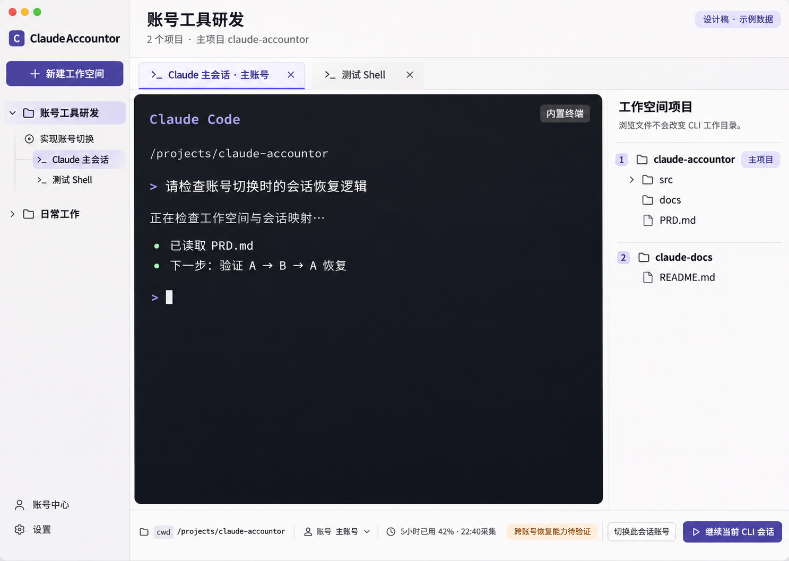
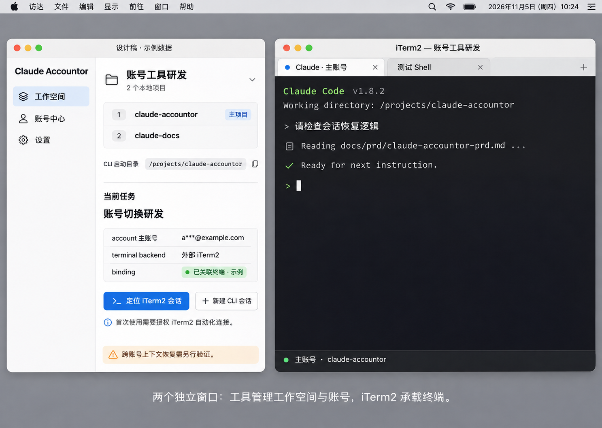
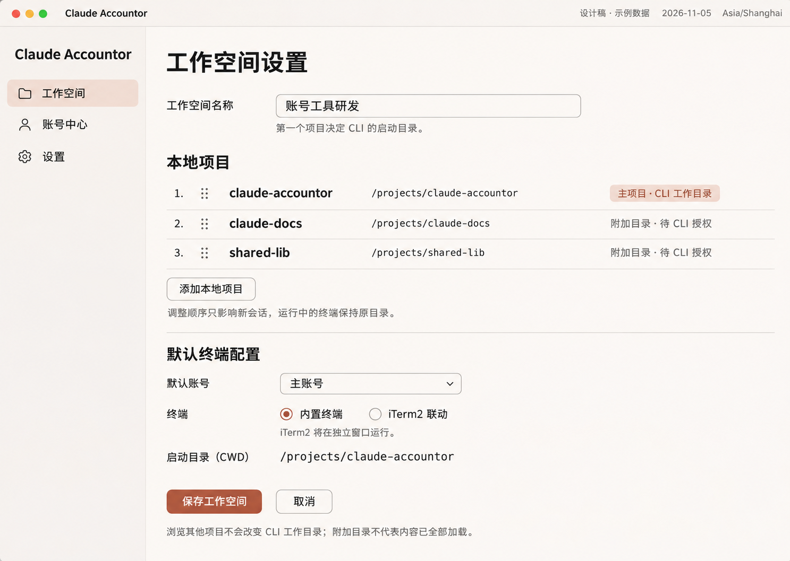

> 历史文档：当前产品名称、仅内置终端与账号卡片改版请以 [终端工作站 PRD](terminal-workbench-prd-v1.md) 为准。

# Claude Accountor 产品需求文档

版本：v0.12 · 日期：2026-11-05 · 状态：0.1.0 macOS Apple Silicon 本地交付；扩展需求仍按阶段规划

本版更新：首版开发及本机集成验证完成，交付范围与证据见[实现与测试报告](../implementation-report.md)。本文保留完整产品方向；P1、跨平台和未覆盖的异常场景不视为已交付。“IT2”按 iTerm2 理解。Claude 网页登录必须仅使用系统设置的默认浏览器，禁止内置浏览器或指定其他浏览器。

## 1. 产品目标

面向拥有多个 Claude Pro 账号的个人用户，提供以工作空间和 CLI 终端为中心的本地桌面工作台：一个工作空间关联多个本地项目，在第一个项目根目录启动官方 Claude CLI，配合普通 Shell、账号额度与会话切换持续工作。

体验优先级：**会话与上下文连续性 > 切换身份正确性 > 内置终端交互质量 > 工作空间组织效率 > 额度可见性**。

平台假设：首版 macOS，中文界面；后续扩展 Windows。这里的“同步”首先指同一台电脑内 Claude CLI 跨账号、跨终端会话的工作延续，跨设备同步不在首版范围。

产品定位：**多项目工作空间 + 内置终端 + Claude 多账号管理**。左侧为工作空间与任务，中间默认为可直接操作的 CLI 终端，右侧按需展开该工作空间的多项目文件树、Git 变更或会话信息。模型推理由官方 Claude Code 执行；产品不另建 Agent 聊天界面。

终端承载方式：

- **内置终端**：把成熟的终端显示组件与系统 PTY 集成到本工具中，CLI 在主窗口内交互。需要开发组件接入、进程管理、中文输入、快捷键和布局等能力，不是从零编写终端仿真内核，也不是直接使用 iTerm2 的渲染引擎。
- **iTerm2 联动**：本工具管理项目、账号和恢复信息，通过官方自动化 API 创建或定位 iTerm2 的窗口、标签、分屏，由独立 iTerm2 应用承载终端。复用用户的 iTerm2 配置与原生交互，但不提供同一窗口内嵌体验。

“接入 iTerm2”与“将 iTerm2 嵌入本应用”必须区分。在已查阅的官方文档中，公开能力主要是应用自动化，没有找到面向其他应用的终端视图嵌入 SDK；这是基于文档覆盖范围的判断，不等于声称所有技术改造均不可能。官方 Toolbelt webview 是把网页工具放入 iTerm2 侧栏，方向与将 iTerm2 放入本工具相反，暂不作为首版路线。[Python API](https://iterm2.com/python-api/)、[Toolbelt API](https://iterm2.com/python-api/tool.html)

## 2. 能力依据与交付边界

### 2.1 账号与登录

官方 Claude Code 文档支持通过 `CLAUDE_CONFIG_DIR` 为各账号保留独立配置、登录和历史记录。产品围绕这一机制管理 CLI 配置档，按受管终端会话核验实际身份。[官方认证说明](https://code.claude.com/docs/en/authentication)

### 2.2 额度与余额

Claude Pro 订阅包含受限制的使用额度，不宜统一表示成美元余额。同一账号在其他官方产品中的使用也可能影响可用额度。产品分别展示五小时窗口、周额度、服务端返回的模型专项限制及其重置时间；额外用量金额只在来源实际提供时显示。[官方用量说明](https://support.claude.com/en/articles/11647753-how-do-usage-and-length-limits-work)

Claude Code 状态栏提供 `rate_limits` 用量数据，但只在满足订阅条件且会话收到首个 API 响应后出现；各窗口也可能缺失。因此，状态栏可提供活动账号的数据，不能单凭它承诺所有闲置账号实时刷新。[官方状态栏字段](https://code.claude.com/docs/en/statusline)

### 2.3 会话延续

官方 CLI 可从本地记录恢复会话。首版本机实测两个订阅账号双向恢复、订阅切到 ZMN 恢复通过；连续 20 次订阅账号切换保留原始记录。DP 网关拒绝原始工具记录结构，因此该入口默认使用可预览和编辑的上下文交接，并按启动参数关闭工具搜索；多轮验证通过。交接保留可见对话事实，不保证原生工具调用状态或隐藏推理恢复。具体 CLI/网关兼容性随版本可能变化。[会话管理](https://code.claude.com/docs/en/sessions)

### 2.4 iTerm2 接入依据

官方 Python API 提供创建窗口/标签、定位窗口、操作会话和创建分屏的能力；脚本可以一次执行，也可以作为长驻桥接进程运行。因此外部联动有明确的官方接口基础，首版已完成本机新建窗口/标签/分屏、定位、管理器重启及真实 CLI 切换测试；其他安装环境仍需验证。[窗口 API](https://iterm2.com/python-api/window.html)、[会话 API](https://iterm2.com/python-api/session.html)、[脚本机制](https://iterm2.com/python-api/tutorial/index.html)

iTerm2 自动化只解决终端承载和控制，不提供 Claude Pro 额度、Claude 登录续期或跨账号上下文迁移；这些仍由各自的 CLI 集成与会话管理负责。

官方文档另提供 Claude Code Integration，通过 hooks 报告工作/等待/空闲状态，并提供 Diff 与 Code Review 的 Workgroup 预设。可研究复用这些能力，减少重复实现；首版通过每次启动传入自己的 hooks，已对四个入口实测，不覆盖用户原有配置；未集成额外的 Workgroup 预设。[官方 Claude Code 集成](https://iterm2.com/claude-code-integration.html)

## 3. 核心使用场景

1. 创建工作空间，选择一个或多个本地项目并确定顺序；第一个标为主项目。选择默认账号后新建 Claude 会话，CLI 在主项目根目录启动。
2. 左侧切换工作空间或任务，回到对应终端；仍在运行的进程继续执行，无需重启会话。
3. 同一工作空间同时打开 Claude 终端和 Shell，分屏查看 Claude 输出、运行测试、查看日志；在辅助栏按项目查看文件与 Git 变更。
4. 在当前任务中切换 A → B：保存检查点，启动 B 对应 CLI，核实身份并恢复；其他任务继续使用自己的账号。
5. 登录失效只影响对应账号；跨账号原会话恢复失败时，在内置 CLI 中使用可预览的交接资料继续。

## 4. 信息架构

- **工作空间侧栏（默认）**：工作空间、置顶任务、最近会话、运行与待输入状态；底部进入账号中心和设置。
- **终端工作区（默认）**：工作空间内多标签、Claude CLI、普通 Shell、分屏与终端搜索。
- **右侧辅助区（可收缩）**：多项目文件树、文件编辑/格式化预览、Git 变更、任务资料、当前账号和恢复信息。
- **账号中心**：账号列表、每个活动会话的实际身份、额度、认证健康、更新时间和切换入口。
- **会话详情**：本地归档、交接资料、账号使用轨迹、CLI 会话与恢复结果。
- **切换记录**：来源账号、目标账号、阶段、身份核验结果、恢复结果和回滚入口。
- **设置**：Shell、字体、主题、快捷键、CLI 路径、工作空间默认值、共享范围和备份。

菜单栏快捷入口展示当前账号、最近采集额度和最近任务；主窗口承担完整管理。

## 5. 关键页面与交互规格

本版附 CLI 工作空间、iTerm2 外部联动、多项目配置三张设计示例，见 5.4—5.6。全部是生成的概念设计，使用虚构数据，不是运行截图或已实现能力证明。旧版图片继续保留为历史文件，不作为本版验收依据。

### 5.1 账号总览

页面必须回答：“我现在用谁、其他账号还能用多少、切过去后接着做什么？”

- 顶部显示当前焦点 Claude CLI 会话的实际账号，同时可展开其他受管会话的账号绑定。
- 账号使用紧凑列表：别名、脱敏邮箱、计划、认证状态、五小时/周额度、重置时间、采集时间。
- 对目标账号提供“切换并继续”；当前账号显示“正在使用”；失效账号提供“重新登录”。
- 未取得额度显示“未知”，旧数据显示“上次采集”，不能显示成零或实时正常。
- 下方仅保留一个主要工作入口：最近任务及其恢复方式。

### 5.2 工作空间

页面围绕“继续工作”组织，账号作为可替换的执行身份。

- 左侧按工作空间列任务，中部显示当前任务的最近会话与检查点。
- 会话信息区显示目标账号、剩余额度、CLI 会话与连续性等级。
- 主操作为“用此账号继续”；在执行前说明会恢复原会话，还是创建携带资料的新会话。
- 可回看 A → B → A 的使用轨迹，每个新分支保留来源信息。

### 5.3 快捷切换

面向频繁切换的用户，使用聚焦的切换面板。

- 明确展示“账号 A → 账号 B”“工作空间”“任务”和“目标 CLI 会话”。
- 步骤为：等待空闲 → 保存检查点 → 切换登录档 → 核验身份 → 恢复会话。
- 有任务运行时，默认“本轮结束后切换”，不抢占正在执行的命令。
- 完成后显示实际账号、CLI 会话和实际恢复结果，而非仅显示“切换成功”。
- 失败保留原资料，展示“返回原账号”及“在新 CLI 会话中交接”。

### 5.4 内置路线：多项目工作空间与终端

主窗口统一采用左、中、右三栏布局：左侧导航，中间主工作区，右侧可收缩辅助区。首次使用沿用右侧收起的默认状态，此后按工作空间恢复用户上次的展开状态与宽度。

- **左侧工作空间树，约 230px**：顶部“新建工作空间”；工作空间可展开任务，任务可展开终端会话。空间设置中管理有序项目列表，第一项标记“主项目 / CLI 工作目录”。显示置顶、最近使用、运行中、等待输入和已结束状态。运行状态只在有可靠信号时展示，否则标为未知。
- **中间主区，自适应**：顶部工作空间名、主项目路径与“共 N 个项目”；Git 分支必须标明所属项目。顶部常驻“＋ 新建会话”分段按钮，终端标签末尾另有“＋”快捷入口，两者共用同一创建流程。下一行是终端标签，每个 Claude 标签直接显示账号别名，普通 Shell 使用独立名称。主体为官方 CLI 的原生终端交互，没有另加聊天输入框。
- **右侧辅助区，初始宽约 320px，可收缩**：以多个项目根节点展示文件树，可编辑文件、查看格式化预览、Git diff、任务资料与检查点。支持顶部按钮一键展开/收起和拖动中右分隔线调整宽度；编辑/预览可展开为独立内容标签。收起后中间区域自动占用释放的空间；重新展开恢复上次宽度和内容。浏览或编辑另一个项目不会改变 CLI 工作目录。
- **底部状态栏**：当前焦点终端的工作目录、进程状态、实际认证账号、额度采集时间；显示“切换此会话账号”入口。

中间顶部始终保留右侧辅助区开关；收起后仍可操作，不能把唯一展开按钮藏入辅助区。展开与缩放采用实际分栏，不悬浮遮挡终端输入；窗口变窄时优先保障主工作区可用，必要时收起右栏并保留恢复入口，不覆盖已保存的偏好宽度。

右栏收起仅隐藏视图，不关闭文件标签、不丢弃未保存草稿、不触发保存、不停止 PTY 或 iTerm2 会话。再次展开保留选中文件、预览/编辑模式、光标与滚动位置。右栏状态属于工作空间，重启后恢复；不随账号切换重置。

iTerm2 联动模式下，本工具仍保持相同三栏结构：中间显示任务、已关联终端和定位/恢复入口；真正的 CLI 交互仍在独立 iTerm2 窗口。右栏的文件编辑、预览和收缩规则与内置模式一致，不能将外部窗口画成已嵌入中间区域。

示例：工作空间“账号工具研发”按序关联 `/projects/claude-accountor`（主项目）与 `/projects/claude-docs`。左侧为“账号工具研发 → 账号切换研发 → Claude 主会话 / 测试 Shell”；Claude CLI 的启动目录始终为 `/projects/claude-accountor`。右侧可同时浏览两个项目，账号按钮只作用于当前 Claude 会话。

主要操作路径：

### 5.5 外部路线：iTerm2 联动

本工具和 iTerm2 是两个独立窗口：本工具保留工作空间、项目顺序、任务、账号及检查点；点击“新建 CLI 会话”在 iTerm2 中创建绑定会话，点击“定位 iTerm2 会话”聚焦对应标签或分屏。终端输入、渲染、回看与快捷键交给 iTerm2。

首次连接显示安装/版本检查和自动化授权引导；连接被拒绝或中断时显示原因与重连入口，不伪装为已连接。这里的窗口并排是示意，不承诺自动排列系统窗口的能力。

### 5.6 多项目工作空间配置

按序列出本地项目，第一项突出“主项目 / CLI 工作目录”；明确显示新会话的启动路径。工作空间设置必须提供“内置终端”和“iTerm2 联动”两个选项，创建时明确选择，编辑时可修改；各工作空间独立保存，可同时使用不同模式。更换承载方式只作用于新会话；旧会话继续由原承载方管理，不声称运行中进程可无缝搬迁。

任务和终端标签显示其实际承载方式，即使与工作空间当前默认值不同也不覆盖。恢复历史会话优先使用记录中的承载方式；需要换一种方式继续时，先保存检查点、停止源会话，再验证目标会话的恢复结果，不能同时写同一份会话记录。iTerm2 未安装、未授权或连接失败时，明确显示问题，并提供用户主动选择“改用内置终端”的入口，不静默改变空间配置。

## 6. 功能需求

### FR-01 多账号管理（P0）

每个账号经官方登录流程首次授权。保存账号别名、账号标识、计划、CLI 配置档引用；不要求在工具中填写 Claude 密码。

按 CLI 账号配置档记录授权状态，受管会话独立核验实际认证来源。重复账号通过稳定账号标识识别，不能仅凭别名合并。

支持重命名、停用与移除。移除默认解除工具管理；会话和配置档清理作为单独操作，执行前明确影响。

### FR-02 额度看板（P0，完整采集能力设验证门槛）

字段：账号、计划、限制类型、已用百分比、剩余比例、重置时间、数据来源、采集时间、采集结果。

数据顺序：官方 CLI 可用结构化输出 → CLI 用量展示 → 引导用户在 CLI 手动查看。若缺少稳定的后台读取方式，首版不得承诺无人值守全量刷新，也不依赖网页抓取补足额度数据。

活动会话尽量随官方输出更新；打开总览展示缓存并尝试刷新可获取来源。非活动账号自动刷新周期必须在技术验证后确定。不得为刷新额度偷偷发送付费或消耗额度的探测消息。

额外用量字段单独表示：已用金额、支出上限、可用余额、币种，只显示来源明确提供的字段。订阅剩余比例、额外用量金额、API Console 余额不能互相换算或混合。

刷新失败保留上次结果和时间，区分离线、需登录、受限、接口不兼容。对错误使用退避重试，禁止无限轮询。

### FR-03 认证维护（P0）

目标是减少重复登录，而非保证永久免登录。正常刷新优先交给官方 CLI；工具跟踪状态与配置档，不自行假设第三方可直接续期订阅凭证。

状态：未授权、有效、检查中、需重新登录、网络未知。检测到授权失效或撤销后，停止该账号的自动维护并引导官方登录；不通过验证码、重新认证或被撤销的令牌继续操作。

同一账号维护任务串行执行，避免多个进程同时更新登录态。重新授权后核验身份，避免浏览器里已有的其他账号被误绑定。

### FR-04 一键切换（P0）

“一键”指账号已完成授权、CLI 版本兼容、源任务处于可切换状态时，一次操作完成后续编排。首次登录、授权失效、任务忙碌等例外须明确展示。

流程：选定任务和目标账号 → 预检查 → 等待安全边界 → 保存检查点与回滚点 → 停止受管源 CLI 进程 → 以目标账号配置档启动 CLI → 核验目标账号和订阅认证 → 恢复 → 展示结果。

正在运行的进程不会因修改默认账号而自动换身份。首版切换仅针对工具管理的 CLI 进程；外部终端不纳入切换与恢复编排。预检查列出当前切换影响的 PTY 和任务，不停止其他受管会话。

如果恢复失败，切换记录中分别显示“身份切换成功”和“会话恢复失败”，不得把整个操作标记成功。目标账号发生额度耗尽、模型不可用或登录失败时，保留检查点并提供回退，不自动循环切换账号。

### FR-05 会话与上下文延续（P0，核心）

连续性分为三种，必须在操作前后可见：

1. **原会话恢复**：经验证后恢复官方本地会话；保留其可恢复的历史、工具结果和压缩状态。不得承诺恢复服务端缓存、隐藏推理过程或仍在运行的子进程。
2. **上下文交接**：目标账号新建会话，携带任务摘要、关键原文、文件与待办。界面明确标注“新会话，已携带交接资料”。
3. **历史归档**：仅能浏览原文和附件索引，尚未将其提供给目标会话；不能标为“上下文已同步”。

交接资料必须包含：用户目标、约束、已作决定、完成内容、未完成项、最近关键消息、文件清单、工作目录、Git 分支与工作树状态、工具执行结果和待确认操作。

摘要可以编辑并可溯源到原始消息；原文始终保留。超出上下文容量时，列明压缩或未加载的范围。摘要生成失败时仍能交接关键原文，不额外要求 API Key。

文件路径不是文件内容：本地附件须检查存在性和访问权限；账号专属附件、Projects 资料、连接器需单独提示并在目标账号重新准备。敏感项目默认只允许同一共享范围内的账号继续。

为每个任务生成工具自己的逻辑 ID，关联不同账号下的 CLI 会话 ID。采用检查点和分支保存，禁止多个 CLI 进程同时写同一份会话。首版不双向传播删除和归档动作。

### FR-06 内置真实终端（内置路线 P0）

终端必须通过系统 PTY 启动真实进程，提供双向输入、输出与窗口尺寸变化；不能使用只读日志面板模拟终端。

首版支持本机 zsh/bash 与官方 Claude CLI。工作空间默认打开 Claude 会话，也可新建普通 Shell；两者默认从第一个项目根目录启动，不在无关 Shell 中默认注入 Claude 订阅凭证。GUI 启动环境与用户终端环境可能不同，必须检查可执行文件路径并提供显式 Shell/CLI 路径设置。

基础交互包括：中文输入法组合输入、多行与大段粘贴、文本选择与复制、滚动回看、终端内搜索、可点击链接、字号与主题配置、常用控制键、CLI 交互菜单、光标移动、全屏 TUI 与窗口缩放。键盘快捷键可配置，优先把 CLI 所需按键传给终端；粘贴多行 Shell 命令保留提交边界，不额外替用户回车。

支持文件拖入终端，转换为正确转义的本地路径。图片直接粘贴能力列为兼容验证项，未验证前不承诺与 iTerm2 完全一致。

终端配置档保存 Shell、字体、配色与允许的环境配置；优先复用现有 Shell 配置。iTerm2 专属脚本与设置不直接承诺兼容。

### FR-07 标签、分屏与进程生命周期（内置路线 P0）

同一工作空间可拥有多个终端标签，每个标签可横向或纵向分屏。每个分屏拥有独立 PTY、工作目录与进程；Claude 分屏另绑定账号配置档和官方会话 ID。

切换标签、工作空间或收起窗口只改变视图，不销毁 PTY。关闭运行中的终端标签需明确区分“隐藏到后台”和“结束进程”；关闭最后一个应用窗口时可选择继续后台运行。操作系统退出、崩溃或彻底退出应用不属于后台运行。

首版由本地 PTY 管理服务持有进程，前端视图与进程生命周期分离。必须控制终端输出缓冲和背压，避免大日志冻结整个应用。进程结束后保留退出码和可配置长度的回看内容；原始终端录屏式日志默认不全量落盘。

应用重启后恢复工作空间、项目顺序、标签、分屏布局与目录；Claude 会话通过精确保存的官方会话 ID 恢复，不能仅用“最近一次会话”猜测。普通 Shell 重新创建，不自动重放上次命令，也不把回看文字当作仍在运行的进程。

### FR-08 多项目工作空间管理（P0）

工作空间是顶层管理单位，包含名称、有序的本地项目列表、任务、终端布局与默认账号配置。项目是对本地文件夹的引用，可以是 Git 仓库或普通目录。创建时可多选项目，并在启动前展示和调整顺序；列表第一项为主项目。导入时规范化绝对路径，在空间内去重，不复制或移动源文件。

**工作目录规则：工作空间内新启动的 Claude CLI，其 `cwd` 必须为第一个项目的根目录。工作空间本身不需要新建一个物理根目录；不使用多个项目的共同父目录，也不随文件树选中项改变。**

其他项目以附加项目目录交给支持该能力的官方 CLI，并遵循其目录信任与访问授权；具体接入方式在兼容验证中确定。附加目录不等于更换 `cwd`，也不代表这些项目的全部内容已加载为上下文。若附加访问失败，明确展示受影响项目，不能显示全部项目已可用。

任务属于工作空间，可有多个官方 Claude 会话与辅助 Shell；记录标题、备注、进行中/已完成状态、启动目录、项目列表快照、检查点与交接资料。普通 Shell 默认也从主项目启动，用户可在 Shell 内自行 `cd` 到其他项目。此处用于组织本地工作，不在首版引入排期、工时和团队权限平台。

工作空间默认值包括账号、CLI 路径、Shell 和启动模式。修改默认账号只影响新会话；运行中会话仍显示自己的实际账号。允许同一空间不同任务分别使用 A、B 账号。

支持新增、移除和排序项目，以及“设为主项目”（等价于移到第一项）。主项目改变后仅影响新启动的会话，不修改运行中进程的目录或自动重启。恢复旧会话时优先使用检查点记录的原主项目路径与项目列表；与当前空间不同时明确提示，可保持原环境恢复，或以新环境新建交接会话，不能静默迁移历史。

创建空工作空间可暂存配置，但未加入项目前禁止启动 CLI。主项目被移除时明确展示继任的第一项；移除最后一个项目后停止提供新会话入口。主项目缺失或无权访问时禁止新启动，不静默改用第二项、用户主目录或空目录；已有进程保持原状并提示。

文件树以多个项目根节点展示。Git 分支、状态、diff 和后续提交操作均独立归属各项目，不把多个仓库合成一个仓库。分支切换、提交、推送、worktree 创建为 P1 的明确用户操作，不随账号切换自动执行；worktree 只有被明确加入并设为首项后才作为新 CLI 的启动目录。

同一个本地项目可以关联到不同工作空间。首版显示共享目录关系：不同任务或空间并行修改相同文件可能相互影响；账号和工作空间隔离不能替代文件隔离。

工作空间支持重命名、置顶、分组、搜索与最近访问。移除项目或删除工作空间默认仅解除引用，保留本地文件与会话归档，不影响其他空间引用的项目。

### FR-09 工作空间中的账号与额度操作（P0）

工具栏中的账号选择器始终作用于当前焦点 Claude 会话。切换操作展示逻辑任务、旧官方会话、目标账号与恢复方式，保存旧会话后创建或恢复目标账号进程。切换一个任务不会修改其他 PTY 的环境或身份。

“新会话使用此账号”“切换当前会话”“设为工作空间默认”必须是三个不同操作。账号总览可列出该账号正在运行的所有会话，但不得以一个全局“当前账号”掩盖并行身份。

额度通知属于账号，所有使用该账号的任务都能看到；多个账号的百分比不能合成为统一余额。来源不确定的终端输出不得被用于判定登录身份、额度或可安全中断状态，优先使用经验证的官方结构化接口或事件，缺少信息时回退为手动操作。

### FR-10 桌面工作效率增强（P1）

提供全局命令面板，搜索工作空间、项目、任务、终端和账号；提供最近任务跳转、终端完成/需输入通知、可配置快捷键、布局模板和工作空间启动配置。使用账号、工作空间或任务维度过滤历史记录。

恢复、搜索与显示历史不默认触发 Claude 请求。SSH、tmux 深度集成、远程开发、完整 IDE 能力、扩展市场和跨设备进程恢复列为后续候选，首版不承诺；轻量文件编辑属于 FR-13 的首版范围。

### FR-11 iTerm2 联动与工作空间终端选择（P0）

首版同时交付两种终端模式。Workspace 保存 `terminalBackend = embedded | iterm2`，每次新建会话取该空间当前配置；会话另保存实际后端和终端引用。修改空间配置不影响其他工作空间，也不修改已运行会话的承载方式。启动目录、账号、额度与上下文规则在两种模式下一致。

在 macOS 上通过官方 Python API 与本地桥接进程连接 iTerm2。使用者安装 iTerm2 并完成必要的连接授权。优先验证官方 Python API，不以已被官方标记弃用的 AppleScript API 作为主实现。[运行脚本与授权说明](https://iterm2.com/python-api/tutorial/running.html)、[脚本接口说明](https://iterm2.com/documentation-scripting.html)

能力范围：按工作空间创建窗口或标签、为任务创建 Claude / Shell 分屏、选择已有 Profile、命名并定位受管会话、监测会话存在性，以及重新连接。CLI 启动仍遵循第一项目根目录、账号独立配置目录和附加目录规则。

记录 `workspaceId/taskId → windowId/tabId/sessionId → Claude sessionId` 映射。iTerm2 会话 ID 只用于定位终端，不等于 Claude 会话 ID，也不应当作永久恢复依据。每次连接先核验映射是否仍有效，失效时标记已结束或待恢复，不向“当前活动窗口”盲目发送启动命令。

只管理本工具创建或用户显式绑定的会话；不改写全局 iTerm2 默认 Profile，不读取或关闭无关窗口。命令通过受控启动器与正确转义的参数启动；不将密码或令牌拼入终端可见命令，不向未知前台程序自动输入 Shell 命令。源会话忙碌或状态未知时不能盲目发送退出或切换命令。

外部路线由 iTerm2 持有终端进程。本工具退出或桥接断开不等于终端结束；重新打开工具时重新发现受管会话。关闭 iTerm2 窗口或退出 iTerm2 后，是否存在可重连进程需实际确认，不能凭缓存显示仍在运行。Claude 会话恢复仍使用官方记录与检查点，终端画面恢复不等于模型上下文恢复。

内置路线的 PTY 缓冲、键盘渲染和应用退出行为不直接用于约束 iTerm2 路线；外部路线相应验收窗口绑定、Profile 选择、身份核验、cwd、断连重连与源进程保护。iTerm2 版本、授权方式与 Python 环境组成单独的兼容验证记录。

### FR-12 文件树内容格式化预览（P0）

文件预览在本工具中完成，内置终端与 iTerm2 模式共用同一套能力。点击文件按扩展名与实际内容识别类型，提供“预览 / 源码”切换；不适用渲染的纯文本仅显示源码。展示所属项目、项目内相对路径与完整路径入口，避免多项目同名文件混淆。

首版格式范围：

- **Markdown（.md）**：渲染标题、段落、列表、表格、引用、任务列表、链接和代码块；代码块支持语法高亮。保留原始 Markdown 视图。Mermaid、数学公式与其他扩展语法列为 P1，未支持时原样显示代码而非空白。
- **代码与纯文本**：常见 JS/TS、Python、Shell、SQL、HTML/CSS 等支持语法高亮、行号、查找、自动换行与复制；未知语言回退纯文本。HTML 首版展示高亮源码，不作为可执行网页运行。
- **JSON / YAML / XML**：提供便于阅读的缩进视图；JSON 支持折叠对象/数组，YAML 保留原始表达与顺序，不经对象序列化丢弃注释。原文件另保留源码视图；格式无效时显示解析位置并回退源码。
- **CSV / TSV**：按列显示只读表格、表头、横向滚动和行数提示，支持包含引号、分隔符及换行的字段；不执行公式，不提供电子表格编辑或重算。
- **图片**：PNG、JPEG、WebP、GIF 提供本地预览、缩放与尺寸信息；SVG 如支持图形预览，须隔离脚本与外部资源，否则回退源码。PDF、Office 文档和音视频预览列为 P1，首版可通过系统应用打开。

“格式化预览”仅改变显示，不能自动写回文件、触发格式化命令、执行脚本、加载终端或发送模型请求。支持复制原文、复制格式化内容（适用格式）、复制路径以及在外部编辑器打开。需要改文件时进入 FR-13 的源码编辑模式，由用户明确保存。

Markdown 内图片与相对链接按当前文件目录解析，不按主项目 `cwd` 解析；跨项目访问按已关联项目范围处理。渲染内容禁用脚本与原始活动 HTML，远程图片默认不自动请求，外部链接由用户点击打开。目录和链接解析不绕过现有访问权限。

只读预览在外部文件变更后保留滚动位置并刷新可见内容；存在未保存编辑时遵循 FR-13 冲突规则，不自动覆盖草稿。文件删除或移动时显示实际状态，不把旧缓存当成最新内容。多文件预览使用标签，关闭预览不停止任何终端。

大文本首版默认以 2 MiB 为完整渲染上限，超过时提示并提供按需加载源码或在外部打开；CSV 使用分批加载，明确已加载行数。二进制、无法识别的编码或不支持类型显示文件信息与外部打开入口，不无限尝试解析或阻塞 CLI 操作。具体限额可在实现验证后调整。

### FR-13 轻量文件编辑器（P0）

点击文件在内容标签中打开，支持“编辑 / 预览”切换。文本模式可直接编辑 Markdown、代码、JSON/YAML/XML、配置文件、CSV/TSV 等；图片、PDF、Office、二进制保持预览或外部打开。CSV 的编辑是源码编辑，表格预览仍只读。普通文本文件直接进入编辑视图，Markdown 可记住上次使用的编辑/预览模式。

首版提供语法高亮、行号、缩进、查找替换、撤销重做、自动换行、多标签、保存和全部保存。支持 `Cmd+S` 保存当前文件，快捷键只在编辑器获得焦点时作用于编辑器，不抢占终端按键；支持编辑区与终端并排查看。自动补全、LSP、调试器、插件体系、可视化富文本编辑和全项目重构不作为首版编辑器要求。

标签显示所属项目、路径和未保存标识；同名文件可区分。默认手动保存，输入内容只更新内存草稿；切换任务、工作空间、终端模式或账号不会丢弃草稿或自动落盘。关闭未保存标签或退出应用时提供“保存 / 放弃 / 取消”；仅明确选择放弃才清除对应草稿。

应用异常退出后可恢复已持久化的本地草稿，标明恢复状态；恢复草稿不自动覆盖磁盘。草稿定期保存与保存原文件是两件事，需保留草稿时间和基准文件版本，以便重启后检查差异。

预览可基于当前编辑缓冲渲染，但必须标注“未保存预览”；只读查看磁盘版本时明确来源。保存成功后才更新磁盘版本标识和相关文件状态。未经用户操作不执行格式化命令；将来增加“格式化文档”时，也须作为明确编辑动作，可撤销并经保存后落盘。

**与 CLI / 外部编辑器并行修改：**打开文件时记录基准内容和文件状态，监听外部变更，保存前再次核验。无本地修改时可重新加载；有未保存内容或发现磁盘版本改变时，不静默覆盖。提供保留草稿、加载磁盘版本和三方差异处理（基准/草稿/磁盘）的入口，冲突解决后再次校验并保存。CLI 的改动与用户手工编辑同等对待。

保存失败、无写权限或文件被删除/移动时保留草稿并说明原因；不报告保存成功，不擅自提升权限，不自动重建已被删除的文件。写入采用避免半文件状态的保存方式，保持原有权限、可识别编码和换行风格；首版优先完整支持 UTF-8，无法可靠处理的编码或超出完整编辑限额的文件转只读并提供外部打开，禁止把截断内容保存覆盖原文件。

同一真实路径在多个任务或工作空间打开时，共享文件版本协调与草稿来源提示，避免应用内部标签相互覆盖。编辑文件不改变主项目、CLI 启动目录、终端当前目录或账号；保存不自动发送 Claude 消息，也不代表运行中模型已重新读取文件。需要 Claude 使用变更时，由用户继续在 CLI 发出指令。

### FR-14 新建会话与窗口入口（P0）

**主入口：**选择左侧工作空间后，点击中间顶部“＋ 新建会话”。按钮主区默认新建 Claude CLI 会话；旁边下拉菜单提供“新建 Claude 会话”“新建 Shell”“左右分屏”“上下分屏”和“继续历史会话”。终端标签末尾的“＋”执行同一个默认新建动作；左侧工作空间/任务菜单也提供对应入口。无终端时仍显示主入口。

默认不弹出重复配置表单：继承当前工作空间的终端模式、默认账号、Shell 和项目列表；Claude CLI 从第一个项目根目录启动。可从下拉菜单进入“使用其他账号新建”，仅对这次创建选择账号，不修改工作空间默认值。默认账号未设置/未授权或主项目不可用时，先显示必要的配置/登录/路径修复入口，条件满足后才创建实际进程。

**任务归属：**选中任务时，新会话加入该任务；仅选中工作空间时，自动创建一个可重命名任务并加入首个会话。每次“新建 Claude 会话”创建独立逻辑会话和官方会话，不自动加载其他会话历史；同属一个任务不代表共享模型上下文。若需继承历史，必须通过“继续历史会话”或明确的交接流程。

**内置模式：**新会话以中间工作区新标签打开并获得焦点；左右/上下分屏在当前标签下创建独立终端 Pane，保持原进程运行。分屏入口允许选择 Claude 或 Shell，沿用相同目录规则。“新增会话窗口”默认是工作区内标签/分屏，不额外创建新的应用顶层窗口。

**iTerm2 模式：**为工作空间维护受管 iTerm2 窗口绑定。已有有效绑定时在该窗口新建标签；无有效绑定时创建窗口；分屏操作定位用户明确选中的受管会话。启动并关联成功后聚焦对应 iTerm2 会话，本工具中间区域同步显示入口和实际状态。不能只聚焦一个旧标签便宣称新建成功，也不能把新窗口/标签当成原 Claude 会话已恢复。

新建 Shell 不自动启动 Claude，也不额外注入订阅凭证。新建与继续历史均不自动发送首条业务指令。创建期间显示启动状态并防止同一次操作重复提交；用户分别点击的多次新建则对应不同会话。启动失败保留错误及重试入口，不留下标为运行中的空标签或重复进程。

新会话在左侧任务列表与中间标签/绑定列表中同步出现，可重命名；显示账号、终端模式和启动状态。首次启动验证完成前显示“启动中/待授权”，不能预先显示身份已核验或会话已恢复。

### FR-15 主题与自定义背景图（P0）

入口为“设置 → 外观”，支持实时预览和恢复默认。首版为应用级偏好，持久保存，重启后恢复。新安装默认跟随系统，不按工作空间或账号自动重置外观。

主题提供：

- **浅灰**：浅灰底色，深色文字，统一导航、终端、编辑器、预览和弹层的配色。
- **黑夜**：深色底色，浅色文字，统一对应界面的配色。
- **跟随系统**：按操作系统的浅色/深色外观分别使用浅灰/黑夜主题，系统切换时应用即时响应。
- **自定义背景图**：选择本地 PNG、JPEG 或 WebP 图片，作为上述任一基础主题的背景层；可替换、移除并保留基础主题。背景图不是单独锁定文字配色的第四套主题，用户仍可选浅灰、黑夜或跟随系统，保障图片背景上的可读性。

**图片不透明度为 0%—100%**，提供滑块与数字输入，同步实时预览；0% 完全隐藏图片、仅显示基础主题底色，100% 显示完整图片强度。该值控制图片层，不控制文字、图标、编辑器内容或整个系统窗口的透明度。图片默认居中覆盖，保持比例，不拉伸；可在首版提供适应/平铺显示选项时另行明确，暂不依赖这些额外选项。

背景图作用于本工具三栏工作台底层，导航与工具条可保留基础主题表面，正文/编辑区/内置终端以必要的主题遮罩保障可读性；不把不透明度直接作用于整棵界面组件。设置中预览实际效果，避免用户误以为 100% 图片强度意味着所有前景表面必须透明。Markdown 图片、文件图片预览等文档内容不受背景图不透明度影响。

导入图片复制到应用受管资源目录，避免源图片移动后失效；不默认上传。读取失败时回退基础主题并提示，不能阻止打开工作空间。移除背景图只清理应用自己的副本，不删除原始文件。

切换主题、调整不透明度或更换图片不重启/重建终端，不清空输出与草稿，不改变工作目录或账号；编辑器与终端配色随基础主题更新，保持选择区、光标、差异和错误提示可辨认。清晰区分系统外观变化与用户固定主题，固定浅灰/黑夜时不被系统外观覆盖。

iTerm2 模式下，上述设置作用于本工具窗口；独立 iTerm2 窗口的配色、背景和透明效果仍由其 Profile 管理。不得为同步外观静默修改用户 iTerm2 全局或其他 Profile。首版不承诺两个独立应用的背景无缝拼接。

## 7. 数据与实现建议

首版实际采用 Electron + React + TypeScript、xterm.js 与 node-pty，已完成真实 PTY 集成与 macOS arm64 打包。原候选 Tauri/Rust 未采用，本机已有 Node 与原生编译工具，Electron 可以直接集成当前终端及 iTerm2 桥接。工作空间、布局、账号元数据与索引使用带串行更新队列的原子 JSON；替代原候选 SQLite。认证凭证继续由各 CLI 配置档及系统凭证机制管理，不复制进应用普通数据库。后续数据规模增长时可迁移存储。

终端后端使用统一适配层，分离 EmbeddedPtyBackend 与 ItermBackend。前者持有 PTY 进程并将输出送至内置视图；后者通过 Python 桥接管理 iTerm2 终端引用，不把 iTerm2 画面镜像成所谓内嵌终端。首版两个后端均需实现，通过工作空间设置选择，已有会话按其实际后端定位与恢复。ItermBackend 的选择不会改变官方 CLI 的账号、目录和会话管理规则。

核心组件：工作空间、项目引用与任务管理器、终端渲染层、本地 PTY 管理服务、账号管理器、官方 CLI 适配器、额度采集器、会话与交接管理器、切换编排器、本地诊断与备份。

关键对象：Workspace、WorkspaceProject（含 position）、Project、Task、TerminalTab、Pane、PtyProcess、Account、ClientProfile、UsageSnapshot、LogicalSession、Checkpoint、HandoffBundle、SwitchOperation。终端 Pane 与 PTY 进程不是官方会话本身：Pane 绑定进程，Claude 进程关联官方会话，任务可关联多个官方会话。会话索引保存版本、来源与校验值；凭证不写入普通数据库和导出文件。

关系：Workspace 通过有序 WorkspaceProject 引用多个 Project；Task 归属 Workspace，终端与逻辑会话通过 Task 归属工作空间。第一条项目引用决定新 CLI 的启动 `cwd`，不单独保存可与顺序冲突的主项目字段。启动记录保存当时的有序项目绝对路径、主项目、附加目录授权结果、账号与官方会话 ID，供重启、换账号及历史恢复使用。

CLI 每个账号使用独立配置目录。会话移交优先采用已验证的官方入口；需要兼容官方会话文件时，先保存只读快照，再向目标配置档创建受控副本，不共享整个认证目录。

启动受管 CLI 时检查可能改变认证来源的环境配置。检测到 API 或代理认证覆盖时，明确显示真实来源；不静默使用 API 费用替代 Pro 订阅。

本地优先保存资料，不默认上传会话。日志不记录令牌、Cookie、授权链接参数或完整会话内容。CLI 会话格式变化时停止写入并保留恢复路径。

## 8. 分阶段交付与退出条件

### 阶段 A：关键能力验证

使用两个已授权账号，在明确记录的 macOS、Shell 和 CLI 版本上验证：

- A/B 登录档隔离，重新启动仍保持身份正确。
- A → B → A 切换，每次核验受管 CLI 实际身份。
- A 的 Code 会话在 B 上恢复，继续一轮后再回到 A；不只检查侧边栏可见。
- 原文、压缩会话、工具结果、文件、MCP 权限和模型差异的恢复表现。
- 活动与非活动账号的额度可获取范围、数据延迟和失败表现。
- 正常续期、撤销授权、离线、CLI 升级后的行为。
- 内置 PTY 下的官方 Claude CLI：中文输入法、确认菜单、控制键、全屏 TUI、大段粘贴、分屏缩放和输出背压。
- 通过桌面图标启动应用时，CLI 路径、Shell 初始化、环境来源与终端启动一致性。
- 多工作空间/多标签分别绑定不同账号，切换其中一个不影响其他终端。
- 切换工作空间保持进程运行，彻底退出后按精确会话 ID 恢复，普通 Shell 不自动重放命令。
- iTerm2 路线需验证首次授权、Profile 选择、创建/定位窗口标签分屏、第一项目 cwd、桥接断开重连和手动关闭终端；管理工具退出不停止 iTerm2 所持有的进程。
- 分别验证 iTerm2 原生 Claude 集成在各账号配置目录下的 hooks 行为及与本工具维护配置的共存，安装或移除集成不覆盖其他 hooks。

退出条件：形成带版本的兼容矩阵，明确每项属于官方支持、实机通过、兼容实现或不支持。两种终端模式均必须能可靠运行官方 CLI；内置路线不能以日志页面替代交互终端，外部路线必须能准确绑定和定位真实 iTerm2 会话。跨账号原会话恢复若不通过，交接模式明确标注差距。

### 阶段 B：可用首版

交付主题与背景图设置、多项目工作空间与任务管理、文件树格式化预览与轻量编辑器、内置和 iTerm2 两种模式中的 Claude CLI / Shell、标签与分屏管理、运行会话重连或恢复、账号管理、实际可获取的额度、认证状态、按会话切换、备份和回退。新 CLI 的启动目录为第一个项目根目录；内置路线在本工具内交互，iTerm2 路线打开独立终端窗口。每个工作空间独立保存终端模式，首版支持两种模式并行使用。未实现跨账号原会话恢复时，发布说明必须明确只有交接模式，不能标为完整满足连续性目标。

### 阶段 C：增强

完善 Git/worktree 操作、命令面板、布局模板、菜单栏与快捷键、批量额度刷新、CLI 版本适配和 Windows 支持。跨设备同步、账号自动轮换、网页聊天迁移不在产品范围。

## 9. 验收标准

账号、工作空间、目录与上下文要求两条路线共用；内置渲染/PTY 项仅适用于内置路线，iTerm2 自动化项仅适用于外部路线。下列条目使用 PTY 描述本地进程测试时，外部路线以实际 iTerm2 会话及其进程作对应验证。

- 至少管理 3 个测试账号，重启工具后绑定关系正确。
- 在已验证版本上连续执行 20 次空闲状态切换；目标身份正确率 100%，源会话零丢失。切换耗时记录中位数和 P95，性能目标待验证基线后确定。
- 原会话恢复用例包括普通会话、长会话压缩、含工具结果、含文件和含未完成事项的会话；用预置事实与原文核对恢复内容。
- 交接模式必须以实际提供给目标会话的内容验收；只生成摘要文件不算已完成交接。
- 运行中切换必须等待或明确中止，不重复执行已完成的外部操作；存在未完成命令时不宣称运行状态已恢复。
- 模拟切换期间启动失败、认证失效、身份不符和磁盘写入失败，均保留源资料并可回到原账号。
- 用量字段与同一账号、同一窗口、相近采集时间的官方展示一致；缺失和过期数据按未知/历史值显示。
- 多个 CLI 会话使用不同账号时，界面能分别显示实际身份；不存在全局“当前账号”误导。
- 日志、备份、交接导出不包含凭证；分享范围之外的项目不能被默认交接给其他账号。
- 通过 GUI 启动应用，创建含多个项目的工作空间后可在第一个项目根目录运行官方 Claude CLI 和普通 Shell，无需先从外部终端启动工具。
- 中文组合输入、编辑、多行粘贴、CLI 菜单、控制键、分屏缩放与回看搜索通过人工交互验收；终端必须可操作而非输出展示。
- 并行打开 2 个工作空间、至少 6 个 PTY，其中包括 A/B 账号和普通 Shell；切换项目保持各进程，切换单个会话账号不改变其他会话。
- 大量持续日志输出期间仍可操作其他终端，缓冲有上限；性能门槛在验证阶段按基准设备明确记录。
- 应用重启恢复布局、目录和精确会话映射；进程未存活时显示已结束/需恢复，不能把回看画面标为运行中。
- 同一工作空间不同任务能分别使用不同账号；修改空间默认账号只影响新会话。移除项目或删除空间不删除源目录。
- 工作空间按序关联 A、B、C 三个本地项目，实际 CLI 进程的启动 `cwd` 必须等于 A 根目录；重启与换账号恢复必须遵循保存的会话环境，不能由当前文件树选中项决定。
- 浏览 B 的文件和 Git diff 不改变终端目录；附加项目按实际授权展示可访问/待授权/不可用，不能将目录列表当成全部内容已加载。
- 将 B 移至首项后，新会话在 B 根目录启动，原有 A 会话不变；恢复旧会话遇到配置差异时展示选择，不静默切到 B。
- 主项目不可访问时禁止新启动，空工作空间禁止启动 CLI；移除主项目明确展示继任者，删除空间不删除任何关联项目文件。
- 同一本地项目可被两个空间关联；两个空间分别保存项目顺序与默认账号，Git 状态按项目独立展示，修改配置互不覆盖。
- iTerm2 路线拒绝授权时准确展示连接失败；重连不重复创建仍在运行的 CLI，不误操作无关窗口。用户手动关闭受管会话后工具能识别失效绑定。
- 终端后端变更只影响新会话，旧会话保持原承载方；不能将创建了新终端误报为成功迁移原进程。
- 工作空间 A 选择内置、B 选择 iTerm2，可同时运行，均从各自第一个项目根目录启动；改变 A 的终端设置不影响 B 或 A 的既有会话。
- 保存设置并重启后，各工作空间保留自己的终端模式；终端标签展示实际承载方式，历史会话不会被新的空间默认值误判或重复启动。
- iTerm2 不可用时展示明确错误及主动改用内置的入口；用户未选择前不自动切换后端、重写配置或创建重复会话。

- Markdown 表格/代码块、代码高亮、JSON 折叠、YAML 注释、含引号与多行字段的 CSV、常见图片按对应方式正确展示；非法格式可回退源码。
- 切换预览/源码、复制内容与打开多个预览后，原文件字节内容不变；不触发模型请求、CLI 命令或工作目录切换。
- 从第二项目打开 Markdown 时，其相对图片从该文件目录解析；内置和 iTerm2 两种模式均可独立使用预览，终端进程不受影响。
- 超限文件、无效编码、文件被外部修改/删除时展示真实状态并保持其他界面可操作；渲染不执行文档脚本或自动加载远程资源。

- 直接编辑代码、Markdown 和配置文件后，未保存标识准确，`Cmd+S` 落盘；预览切换和单纯复制仍不改变磁盘文件。
- 用户编辑未保存期间，CLI 或外部编辑器修改同一文件，应用提示冲突并保留双方内容；未解决前不静默覆盖，保存失败不清除草稿。
- 关闭标签/退出应用提供保存、放弃与取消；切换工作空间/账号/终端模式保留草稿，异常退出后可恢复已持久化草稿且不自动覆盖磁盘。
- 只读、超限、非支持编码和被删除文件不能被误报保存成功；不允许将分段预览内容保存成完整原文件。
- 两种终端模式下均能编辑附加项目文件，CLI 目录和身份不变；同一真实文件的多标签编辑不互相静默覆盖。

- 主窗口采用左中右三栏；右侧可一键展开/收起、拖拽调整宽度，收起后中间区域扩展，展开后恢复先前宽度，不遮挡终端。
- 右侧收起再展开、切换账号及重启恢复时，按工作空间保留布局、文件标签和已持久化草稿；收起不保存文件、不结束终端，展开入口始终可见。
- 内置和 iTerm2 模式均遵循三栏与右侧收缩规则；外部模式中间呈现会话管理入口，不伪装成内嵌的 iTerm2 终端。

- “＋ 新建会话”在有/无终端及右栏收起时均可见；顶部、标签末尾和左侧菜单使用相同创建规则。
- 新建 Claude 会话继承空间配置，在第一个项目根目录启动，创建独立上下文；继续历史通过单独入口按确切会话 ID 恢复，不误用最近一次记录。
- 内置模式新建标签或分屏，iTerm2 模式创建并绑定对应窗口/标签/分屏；新建不会结束已有会话，首次无窗口和已有窗口两种情况均可用。
- 缺少账号/授权/主项目、创建失败或重复提交时，显示准确状态，不产生误报运行或同一次请求的重复进程。

- 浅灰/黑夜可手动切换；跟随系统模式即时响应系统变化，固定主题不受系统切换覆盖；重启保留外观偏好。
- 背景图可选择、替换和移除，不透明度滑块与数值输入一致，0%/50%/100% 各自效果正确；前景文字、文档内图片和图标不被一起淡化。
- 主题及背景变更保留终端进程、光标/滚动位置、文件草稿和右栏状态；内置终端与编辑器配色同步基础主题。
- 导入图片后移动原始文件仍可显示；图片资源损坏时回退基础主题，移除背景图不删除用户源文件；iTerm2 Profile 不被本工具外观设置改写。

## 10. 产品决策

建议把“在工作空间中跨项目持续工作”作为产品主线。体验是：**选择工作空间 → 确认有序项目列表 → 打开任务 → 在第一个项目根目录运行 Claude CLI → 按需切换账号并继续**。普通 Shell 与 Claude 终端共享工作空间组织方式。用户已确定首版两种终端模式均支持，由工作空间独立选择：内置模式在本工具内操作，iTerm2 模式定位独立终端窗口。

开工前最关键的证据是两种终端模式的 CLI 交互与控制兼容、两个真实账号间的会话往返恢复，以及所有账号额度能否可靠读取。当前设计图见 5.4—5.6，旧版图只保留为历史文件；本文与设计图均不代表上述能力已实现。
