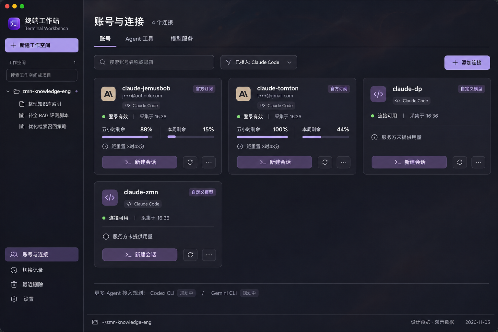

# 终端工作站 PRD

版本：v1.0 · 日期：2026-11-05 · 状态：方案一已实现并完成本机验证；0.2.1 已支持自动独立账号及自定义供应商/模型编辑；新增 Agent 仍按阶段规划

英文名：Terminal Workbench。本文取代旧 PRD 中的品牌名称、外部终端支持和账号总览设计。旧文档保留为历史，不再作为新版本实施依据。

本文分开记录已经确认的产品约束、正在交付的基础改动，以及待选定视觉方案的账号管理改版。示例图是概念设计，使用演示数据；其他 Agent 的出现不表示已经接入。

## 1. 产品定位

终端工作站是以本地项目和内置 CLI 终端为核心的桌面应用。用户在工作空间组织项目、选择 Agent 工具及执行身份，通过真实终端开展开发工作，并在右侧查看文件、编辑内容和检查 Git 变更。

产品面向同时使用多个订阅账号、API 配置及不同 Agent CLI 的个人开发者。首页仍然是工作空间与终端，不新增 Agent 聊天窗口替代 CLI。

优先级：会话与上下文连续性、执行身份正确、终端交互稳定、账号信息易读、多 Agent 可扩展。

## 2. 本次问题与改版目标

当前账号页面用整行展示一个账号。名称、邮箱、订阅标记、两个用量条、采集时间和三项操作横向分散，四个账号就占据大半页面。自定义模型同样展示“五小时、周额度未知”，用户难以判断是暂未采集，还是服务根本不提供这些数据。

改版后，账号作为独立卡片呈现。用户打开页面后，应能迅速完成三个判断：这是什么工具的什么身份、目前能否使用、还有多少可用量。

目标：常规桌面窗口无需滚动即可看到现有四个连接；账号名称、认证状态、额度含义保持清楚；添加新 Agent 不需要复制一套账号页面；不支持的额度和恢复能力有明确解释。

## 3. 已确认的全局约束

- 应用名称为“终端工作站”，英文名 Terminal Workbench；保留终端主题的紫色图标。
- 仅使用内置终端，移除 iTerm2 选择、联动、定位及桥接依赖。迁移不强关用户外部窗口。
- 工作空间固定按创建时间倒序排列，切换会话、选择工作空间、修改配置不改变位置。旧版没有创建时间的空间按原始创建顺序稳定迁移，不伪造实际日期。
- 工作空间关联多个有序本地项目，第一个项目根目录作为 CLI 工作目录，附加项目由工具适配器按实际能力处理。
- 左、中、右布局继续保留：左侧工作空间与会话；中间真实 CLI；右侧文件、编辑预览与 Git。左右可收起，工作空间展开箭头平滑旋转且文件夹图标随状态开合，文件预览可上下调节并放大至中间与右侧区域。
- 保留浅灰、黑夜、跟随系统和自定义背景图。卡片使用足够不透明的表面，保证背景图片下文字与额度可读，不擅自覆盖用户设置的背景不透明度。
- 保留终端字体、字号、行高、复制、滚动和分屏功能。
- 左侧会话项与中间标签只在实际工作状态显示边框跑马灯，分屏组内任一会话工作时提醒；等待输入、空闲和退出恢复原样。遵循系统减少动态效果设置。
- 所有网页登录只通过系统设置的默认浏览器，不使用内置浏览器或指定其他浏览器。
- 不把未知额度显示成零，不用模型调用探测余额，不把认证检查成功当作用量刷新成功。

## 4. 三个基础对象

### 4.1 Agent 工具

代表实际执行任务的 CLI，例如 Claude Code。工具记录名称、图标、可执行路径、检测版本以及自身支持的能力。

未来可评估 Codex CLI、Gemini CLI、OpenCode 等候选。首次进入时，这些候选只能显示在“待接入工具”区域，带“规划中”状态，不能出现可点击的“已连接”账号卡片。

### 4.2 账号与连接

代表某个工具使用的一套认证身份或启动配置。官方订阅登录、引用本地独立配置和自定义 API 连接需要分开标识。

卡片是“可选执行身份”的入口。一个工具可以关联多个连接；不同工具即使使用同一家服务，也不自动共享登录或凭证。只有适配器明确支持、用户主动授权时，才建立共享凭证引用。

### 4.3 模型服务

代表 API 地址、服务商和模型配置。服务商、Agent CLI 和账号订阅不混为一项。

以现有四个入口为例：`claude-jemusbob`、`claude-tomton` 是 Claude Code 下的官方订阅身份；`claude-dp`、`claude-zmn` 是 Claude Code 下的自定义模型配置，不作为两个新的 Agent 产品。

## 5. 信息架构

左侧保留工作空间、会话、切换记录、最近删除和设置。“账号中心”升级为“账号与连接”。

“账号与连接”内部提供三个页签：

- **账号**：紧凑卡片，完成身份选择、状态查看、新建会话和当前会话切换。
- **Agent 工具**：检测和配置 CLI，查看各工具已验证的能力；未接入工具显示规划状态。
- **模型服务**：管理自定义 Endpoint 和模型配置，由所选工具的兼容性决定是否可用。

初次改版优先交付账号卡片和详情面板。其他页签按实际实现开放，不提供点击后无反馈的占位入口。

## 6. 账号卡片规格

### 6.1 页面布局

顶部为标题、连接数量、搜索和“添加连接”主按钮。撤去大段宣传文案和长期占位的添加账号输入框。

第二行放工具筛选与必要的状态筛选。筛选项只统计当前实际存在的连接；未接入工具不产生虚假的“0 个已连接账号”。

桌面宽度充足时三列卡片，中等宽度两列，最小窗口或详情面板展开时一至两列。卡片建议宽度 280–360px、高度约 200–240px；实际以长账号名、中文和最小窗口验证为准。四个现有连接在常规窗口首屏可见。

### 6.2 卡片信息优先级

第一行：工具图标、账号别名、更多操作。卡片不再使用通用人像占据大片空间。

第二行：脱敏身份或简短启动入口；一枚连接类型标记；认证状态用文字与状态点共同表达。身份、类型、状态不堆成三排大标签。

中部：最多两个主额度指标。Claude 订阅优先显示“五小时剩余”“本周剩余”，统一使用“剩余”语义。剩余比例根据可靠的已用百分比计算，保留来源及采集时间。

额度下方：五小时重置倒计时，必要时显示周重置时间。具体时间和采集来源可在悬停提示或详情面板展开。

底部：一个主要操作和一至两个次要入口。常态主按钮为“新建会话”；认证失效时替换为“重新登录”。更多操作中提供“切换当前会话账号”，只有当前会话与目标连接属于同一工具且状态允许时启用。

### 6.3 不同连接的额度展示

官方订阅：展示工具实际提供的窗口，不把 5 小时和周窗口硬编码成所有 Agent 的通用概念。

自定义模型：提供商有余额接口时，展示金额、币种、更新时间和计费主体；只有 Token 计数时，显示相应计数，并标明它不是余额；没有用量接口时，仅显示“服务方未提供用量”，不画两条“未知”的订阅额度条。

尚未采集：显示“等待会话采集”。来源暂时失败：显示“暂不可用”，保留上次采集值与时间。来源不支持：显示“不提供”，不周期性重试不存在的接口。

设计阈值：剩余不高于 10% 提示“余量偏低”；11%–30% 使用较弱提醒；高于 30% 为普通状态。提醒同时有文字，不只靠颜色。无已知值时不参与低余额判断。

用量采集超过 5 分钟时标明“上次采集”，不能仍被理解为实时数据；最终阈值可在验收前根据实际适配器刷新能力调整。

### 6.4 卡片操作边界

点击卡片正文打开详情，不直接切换正在运行的账号。

“新建会话”打开轻量选择器：工作空间、Agent 工具、执行身份。默认填入当前工作空间；确认后在该空间主项目根目录启动内置 CLI。不会改写其他会话的身份。

“切换当前会话账号”沿用检查点与恢复流程：展示来源和目标、确认回合已结束、启动目标、核验就绪后移除源条目。失败保留源记录和检查点。

刷新图标的名称为“检查连接状态”。如果当前适配器无法主动拉取用量，提示“额度随实际会话更新”，不更新时间戳冒充用量已刷新。

更多菜单包含：查看详情、重命名、重新认证、设置此工具的默认连接、移除引用。移除引用保留底层配置和凭证；运行中的会话仍按现有保护规则阻止移除。

## 7. 连接详情与添加流程

### 7.1 详情面板

从右侧展开，保留卡片列表的位置和筛选状态；面板可关闭。

详情依次展示：工具与连接身份、认证方式与检查结果、可用量和来源、模型服务配置、关联工作空间与活动会话、启动配置摘要。

卡片只展示最常用信息。CLI 版本、配置目录、Endpoint、完整身份、错误详情和日志入口放在详情里。凭证只展示引用及脱敏信息，不直接展示完整密钥。

### 7.2 添加连接

第一步选择已接入的 Agent 工具；第二步选择连接方式；第三步填写或引用配置并验证。

Claude Code 首阶段保留三种来源：引用本机已有启动入口、新建官方订阅登录配置、自定义模型配置。扫描结果改为添加面板中的候选列表，不长期占据主页面顶部。

本地入口只建立引用，不复制用户现有凭证。网页登录使用系统默认浏览器。自定义 API 由对应适配器验证支持的认证方式；“验证成功”只代表该验证覆盖的内容，不能据此声称所有模型或额度接口均可用。

创建过程中可以取消。用户取消不会结束其他会话，也不会覆盖已有默认连接。

## 8. 会话标题、恢复与删除

新会话先分配可区分的名称。Claude 会话从首条有效任务文字提取短标题，过滤简单问候、工具结果和系统包装；不额外调用模型。标题附稳定短标识，同主题会话仍可区分。

手动命名优先，后续任务内容不覆盖。标题在侧栏、终端标签、历史和最近删除中保持一致；恢复和账号切换保留逻辑会话的标题。

恢复运行中会话直接打开原入口；中断会话确认目标就绪后移除源条目。自动替换不进入最近删除。

最近删除按“工作空间 → 会话”保留手动删除的会话 7 天。恢复失败保留归档；过期记录不能恢复。每条提供“永久删除”，二次确认后移除本工具恢复记录及未被其他记录引用的专用检查点，不能再通过本工具恢复。项目文件和 CLI 原始历史保留。

跨 Agent 的“继续任务”需要单独设计为显式交接：预览任务、已完成内容、未完成事项和可共享资料，确认后创建目标工具的新会话。不能将其标为原生会话完整恢复，也不能承诺迁移后台进程、工具内部状态或隐藏推理。该能力属于后续阶段。

## 9. 多 Agent 扩展契约

每个工具适配器声明能力：检测安装、创建会话、检查认证、发起登录、读取用量、按精确 ID 恢复、原生切换身份、上下文交接、附加项目目录。

能力状态分为“已验证支持”“不支持”“待验证”。只有已验证支持的能力开放操作入口。待验证不等于可用。

通用页面负责卡片、筛选、交互、错误状态和工作空间关系；适配器负责工具特有的认证、启动参数、用量解释和恢复协议。

连接状态和额度状态分开保存。例如认证有效但额度不支持，卡片应显示“可使用 / 服务方未提供用量”，不能显示成连接异常。

窗口用量按 `id、名称、已用或剩余、单位、周期、重置时间、来源、采集时间、支持状态` 表达；不得给所有 Agent 强塞 `five_hour` 和 `seven_day`。

同名连接依靠工具、类型、身份和连接 ID 区分；工作空间默认值按工具分别保存，不设一个会影响所有 Agent 的全局账号。

## 10. 迁移与兼容

应用更名保留既有数据目录与身份引用，迁移过程不复制凭证。旧版本仍运行时提示先退出，避免两套应用同时写入同一状态文件。

工作空间和旧会话迁移为内置终端。仍在外部运行的旧 CLI 不会被关闭；恢复旧外部记录前提示先结束原 CLI，避免并行操作同一会话。

现有 account ID 映射到新 connection ID 时保留稳定引用；现有四个入口均归属 Claude Code 适配器。旧工作空间绑定默认映射为 Claude Code 的默认连接，不能跳到其他工具。

旧版自定义模型配置迁移为“工具连接 + 模型服务引用”，原有包装脚本路径、配置目录和模型参数保持可追踪，不擅自改写包装脚本。

迁移失败停止写入并提供原因，保留原状态文件和回退资料。没有可验证恢复依据时不启动空白对话冒充恢复。

## 11. 性能与可读性要求

认证检查按需触发并复用在途请求；设计并发上限为 2，避免为每张卡片同时启动 CLI。

用量优先消费实际会话事件。没有可靠用量读取能力的工具不后台轮询，不通过新发模型提示制造用量数据。

标题补齐只读取关联会话的受控本地记录，限制单次读取大小；已取得任务标题或手动标题后不逐回合重复扫描。

延续草稿写入合并、终端输出批量传输、隐藏文件面板暂停读取和有界终端缓冲。账号页只读状态变化，不因每次终端输出重建整页。

卡片在浅色、深色和自定义背景下验证对比度；键盘可访问卡片操作与菜单。长别名、缺失身份、未提供额度不能挤掉主按钮。

## 12. 交付阶段

**基础改动**：更名、仅内置终端、自动标题、最近删除中的永久删除。单独记录构建与实际测试结果。

**账号管理改版**：选定示例图后实现卡片、连接详情和添加流程，先覆盖当前四个 Claude 配置。通用数据结构和适配器能力同时落地。

**新增 Agent**：按工具逐一做安装检测、认证、启动、用量和恢复验证。没有通过验证的能力保持关闭；具体支持清单以对应版本交付报告为准。

本次 PRD 不承诺所有候选 Agent 同时接入，也不承诺跨 Agent 原生上下文完全同步。

## 13. 验收清单（设计用例，尚非改版执行结果）

1. 四个现有连接在常规窗口首屏可见，名称、工具和类型可区分。
2. 两个官方订阅卡片显示可靠的五小时与周剩余，已用 0% 对应剩余 100%，未知值保持未知。
3. 两个自定义模型卡片不出现不适用的订阅额度条。
4. 5 小时倒计时本地更新；到期等待服务端数据，不伪造满额。
5. 状态检查成功不会刷新旧用量的采集时间。
6. 卡片正文打开详情，主操作只作用于明确选定的工作空间和会话。
7. 运行中、未结束回合或身份不明确时，禁止执行不安全的切换。
8. 登录仅打开系统默认浏览器，已有启动入口不复制凭证。
9. 新建连接取消、认证失败或验证超时，不修改其他连接。
10. 搜索、工具筛选与状态筛选共同生效，切换详情后保留筛选与滚动位置。
11. 旧版四个入口、工作空间默认项、草稿和恢复关系迁移后可用。
12. 待接入工具不显示为已连接；不支持的能力有说明且无法触发。
13. 相同首条任务仍生成可区分标题；手动名称不被自动任务标题覆盖。
14. 恢复成功只留一个入口，失败保留原会话，自动替换不进入最近删除。
15. 永久删除可取消；确认后重启也不能从本工具恢复该记录，其他会话与共享检查点不受影响。
16. 最小窗口、长名称、深浅主题、自定义背景和键盘操作均完成真实界面验证。

## 14. 视觉评审

提供三张独立概念图。它们共用上面的对象模型、操作规则和能力边界，只比较布局、信息密度和详情展开方式。

按本次会话中的实际展示顺序编号：

1. [方案一](assets/account-grid-v1.png)：已选定，作为实现视觉目标。
2. [方案二](assets/account-grouped-v1.png)：历史备选。
3. [方案三](assets/account-details-v1.png)：历史备选。

图中的数据为演示数据，不作为真实额度或已交付能力证明。0.2.1 模型服务支持新建和编辑应用管理的自定义 Endpoint、密钥和模型；原有脚本引用继续保留。其他 Agent 原生接入、OpenAI 协议转换和跨 Agent 交接仍属于后续阶段。

## 15. 依据与证据

产品需求来自本次会话和用户提供的实际应用截图。当前实现与已执行测试见 [实现报告](../implementation-report.md)。

Claude 标题采集使用本地 UserPromptSubmit 事件及已存在的本地会话记录；事件字段依据 [官方 Hooks 文档](https://code.claude.com/docs/en/hooks#userpromptsubmit)。其他 Agent 的协议与能力需在对应接入阶段另行核验。

## 16. 0.2.1 添加连接与配置编辑

“添加连接”提供本机现有入口、独立官方配置、自定义供应商三类。独立官方配置自动生成账号专属目录和应用数据 `bin/` 下的唯一可执行入口；详情支持复制完整启动命令，不覆盖已有系统脚本。用户可先创建或“创建并登录”，后者调用官方 CLI 并强制系统默认浏览器打开授权。认证刷新仍由 CLI 管理。

自定义连接表单包含连接别名、供应商名称、Anthropic Messages 兼容地址、Bearer/x-api-key 认证、密钥、模型 ID 列表与默认模型。使用所选默认模型启动；模型名称需服务方支持，保存和本地配置检查不冒充实际推理验证。API Key 仅使用系统安全存储加密后的本机文件，普通状态和界面详情不返回密钥；编辑留空保持现有密钥。更新仅影响后续启动/恢复，会话运行中的环境不变。状态写入失败回收新密钥版本并保留旧配置；在途启动使用原配置与对应密钥版本。原脚本引用不能直接编辑为托管连接。

工具筛选与搜索的焦点边框包裹图标和输入部分，避免内层原生控件焦点框与图标相交。表单遵循当前主题，窄高窗口可滚动。自定义服务卡片不显示订阅额度，本地检查通过显示“配置就绪”。
